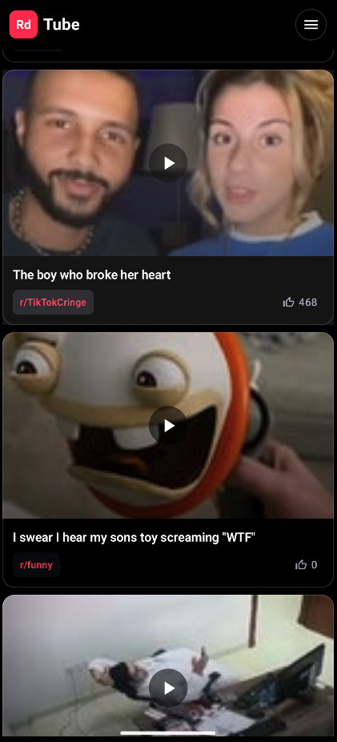
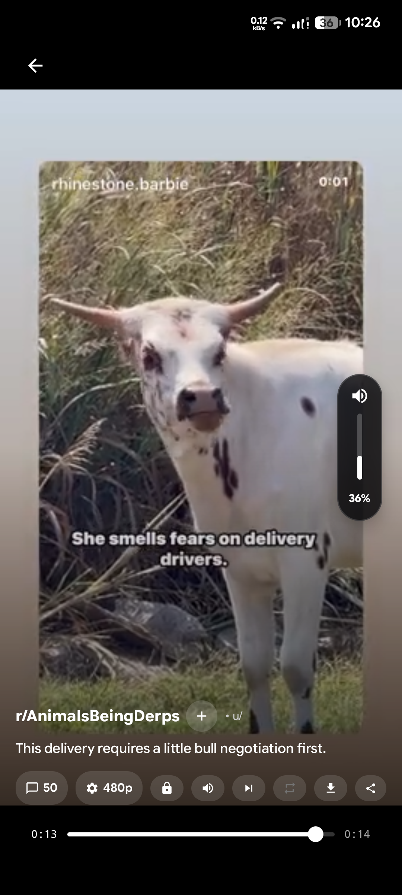
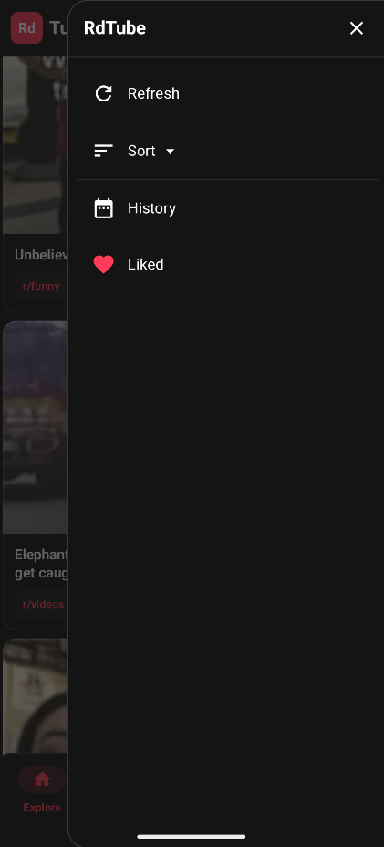
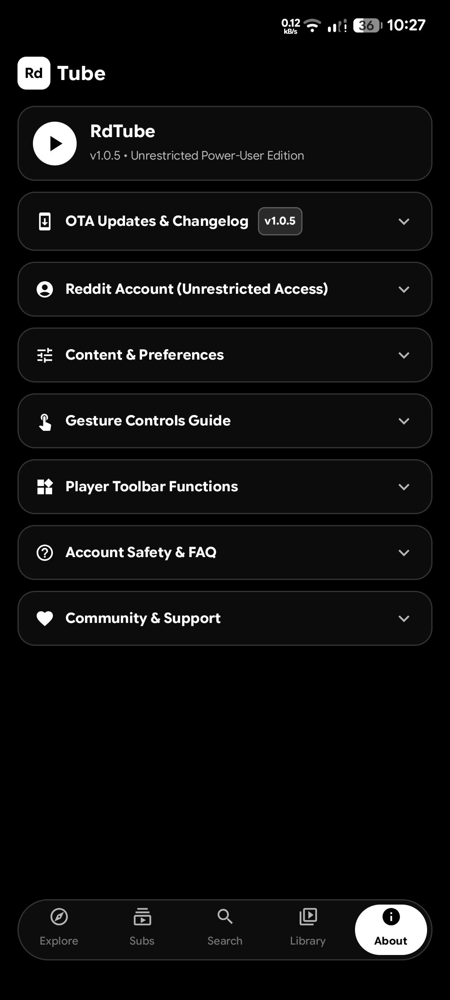
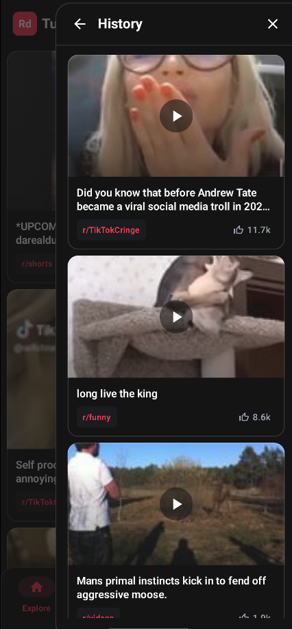
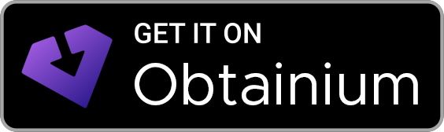

# RdTube

<picture>
  <source media="(prefers-color-scheme: dark)" srcset="docs/images/rdtube_banner_dark.svg">
  <source media="(prefers-color-scheme: light)" srcset="docs/images/rdtube_banner_light.svg">
  
</picture>

<div align="center">

[](https://github.com/LeanBitLab/RdTube/releases/latest)
[](https://github.com/LeanBitLab/RdTube/releases)
[](https://github.com/LeanBitLab/RdTube/stargazers)
[](https://www.gnu.org/licenses/gpl-3.0)
[](https://github.com/sponsors/LeanBitLab)
[](https://opencollective.com/leanbitlab-org)

**A private, fast and sleek open-source video client for Reddit.**<br>
Built with Media3 ExoPlayer and Jetpack Compose. OLED pitch black, feed prefetching and zero tracking.

[Download](#download) • [Features](#features) • [Setup](#setup) • [More LeanBitLab apps](#more-leanbitlab-apps) • [Support](#support)

</div>

<table>
  <tr>
    <td></td>
    <td></td>
    <td></td>
    <td></td>
    <td></td>
  </tr>
</table>

## Why RdTube

- **Private by design**: liked videos, watch history and subscriptions stay strictly on your device with zero telemetry.
- **Fast video playback**: hardware-accelerated Media3 ExoPlayer playback with configurable background feed prefetching.
- **Tactile gestures**: vertical edge sliders for brightness and volume, double-tap seeking and horizontal swipe actions.
- **Search and discovery**: real-time video search filters, unified search history and multi-subreddit feeds.
- **Anonymous or signed in**: browse out of the box with zero registration, or sign in with read-only Reddit OAuth to unlock restricted feeds.
- **OLED dark theme**: high-contrast pitch black interface built for battery efficiency on OLED displays.

## Download

<table border="0">
  <tr>
    <td align="center"><a href="https://github.com/LeanBitLab/RdTube/releases/latest"></a></td>
    <td align="center"><a href="https://apps.obtainium.imranr.dev/redirect.html?r=obtainium://add/https://github.com/LeanBitLab/RdTube"></a></td>
  </tr>
</table>

One universal APK (`app-release.apk`) for all devices. Requires Android 7.0+.

## Features

| Area | Highlights |
| :--- | :--- |
| **Video playback** | Hardware-accelerated Media3 ExoPlayer; configurable feed prefetching; source preview thumbnails; MP4 export with audio; loop, auto-advance, speed (0.5x to 2.0x) and mute controls; persistent rotation lock |
| **Gestures & navigation** | Vertical edge sliders for brightness and volume; double-tap seeking (10s); swipe to like or dismiss with haptics; 5-slot floating dock; sequential back stack |
| **Search & discovery** | Top search bar; subreddits and videos tabs; real-time filters (Relevance, Hot, Top, New, Comments); unified search history; multi-subreddit feed sorting |
| **Privacy & data** | Strictly local library for likes, history and subscriptions; instant history clearing via StateFlow; zero tracking or external sync |
| **Reddit access** | Zero-setup anonymous guest browsing; optional 1-tap read-only OAuth for unrestricted and NSFW feeds; optional developer API key overrides |
| **Comments** | Account-free discussion bottom sheet; top comments; post metadata with author and score badges |
| **Look & feel** | Pitch black OLED theme; auto-mute NSFW videos; thumbnail quality settings with 1-tap cache clear; tactile haptics |

## Setup

RdTube works immediately out of the box with zero setup and no account required. Signing in via Reddit OAuth is optional and unlocks unrestricted subreddits.

| Mode | Access | Settings screen |
| :--- | :--- | :--- |
| **Guest** (default) | Standard and SFW feeds, shared guest quota | None (ready out of the box) |
| **Signed In (OAuth)** | Unrestricted and NSFW feeds, dedicated user quota (100 req/min) | **Settings → Reddit Account & API Keys → Connect Reddit Account (1-Tap)** |
| **Developer Overrides** | Custom Client ID, User Agent and Redirect URI | **Settings → Reddit Account & API Keys → Enable Overrides** |

<details>
<summary><b>Reddit API notes and developer overrides</b></summary>

- **Reddit app restrictions**: direct OAuth app creation on `reddit.com/prefs/apps` is restricted by Reddit Developer Terms. Out of the box, RdTube requires no personal Client ID.
- **Developer overrides**: if you hold an approved Reddit developer application, toggle on **Enable Overrides** under **Settings → Reddit Account & API Keys** to configure your personal Client ID, User Agent and Redirect URI.
- **Account safety**: authentication uses official read-only scopes (`identity`, `read`, `mysubreddits`) in your browser. Passwords are never handled or stored by RdTube.

</details>

<details>
<summary><b>Building from source</b></summary>

Prerequisites: Android Studio, JDK 17+, Android SDK API 36 (min API 24).

```bash
git clone https://github.com/LeanBitLab/RdTube.git
cd RdTube
./gradlew assembleRelease
```

</details>

## More LeanBitLab apps

| App | What it is |
| :--- | :--- |
| [LeanType](https://github.com/LeanBitLab/LeanType) | Private, smart and customizable keyboard with AI, voice and offline options |
| [LtvLauncher](https://github.com/leanbitlab-org/LtvLauncher) | Fast, private and ad-free launcher for Android TV |
| [Lwidget](https://github.com/LeanBitLab/Lwidget) | Material You information widget with no internet permission |

See [all LeanBitLab projects](https://github.com/LeanBitLab#-android-apps).

## Community

[Issues](https://github.com/LeanBitLab/RdTube/issues) • [Telegram](https://t.me/LeanBitLab) • [Reddit](https://www.reddit.com/r/LeanBitLab_/) • [X](https://x.com/LeanBitLab) • [YouTube](https://www.youtube.com/@LeanBitLab) • [Website](https://leanbitlab.github.io/LeanBitLab/)

## Support

RdTube is community-funded. If it improves your daily video browsing, consider backing development on [GitHub Sponsors](https://github.com/sponsors/LeanBitLab) or [Open Collective](https://opencollective.com/leanbitlab-org).

## Credits and license

Inspired by [Continuum](https://github.com/alien-m/continuum) by alien-m, built with [Media3 ExoPlayer](https://github.com/androidx/media) and [Jetpack Compose](https://developer.android.com/jetpack/compose). Thanks to all [contributors](https://github.com/LeanBitLab/RdTube/graphs/contributors).

Licensed under [GPL-3.0](LICENSE).
