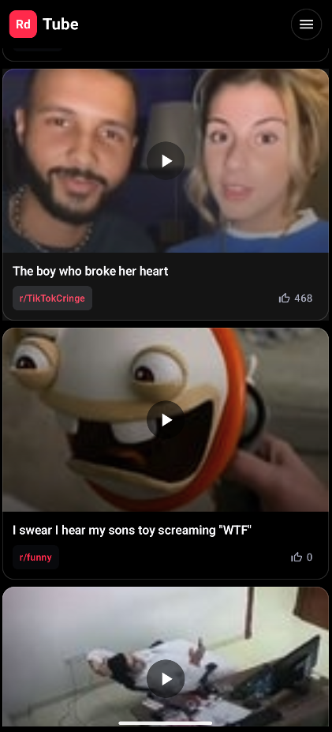
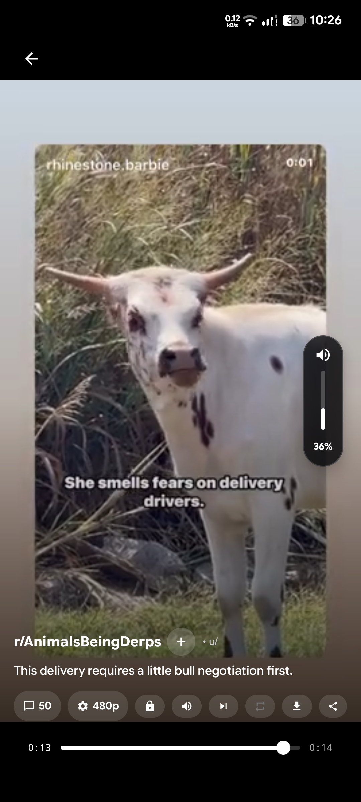
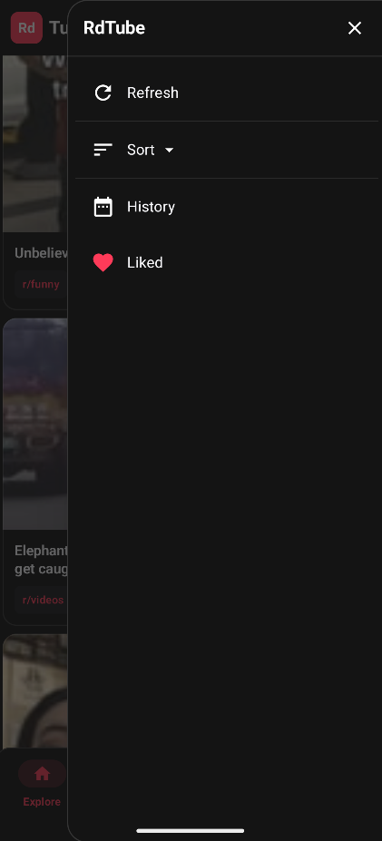
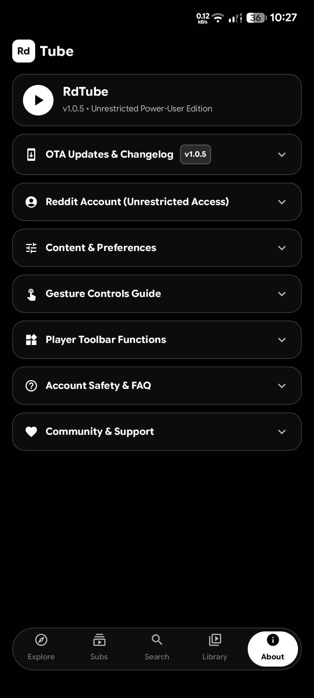
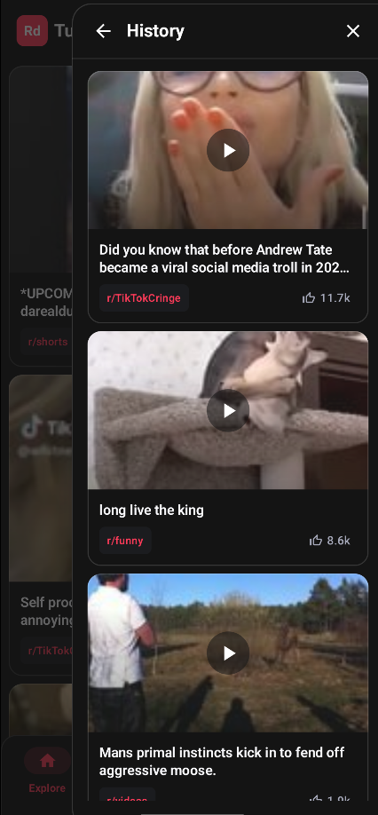

# RdTube

<picture>
  <source media="(prefers-color-scheme: dark)" srcset="docs/images/rdtube_banner_dark.svg">
  <source media="(prefers-color-scheme: light)" srcset="docs/images/rdtube_banner_light.svg">
  
</picture>

<div align="center">

[](https://github.com/LeanBitLab/RdTube/releases/latest)
[](https://github.com/LeanBitLab/RdTube/releases)
[](https://github.com/LeanBitLab/RdTube/stargazers)
[](https://www.gnu.org/licenses/gpl-3.0)
[](https://github.com/sponsors/LeanBitLab)
[](https://opencollective.com/leanbitlab-org)

**A private, fast, and sleek open-source video client for Reddit.**  
*Pure OLED pitch black, high-speed feed prefetching, and zero tracking.*

[Screenshots](#-screenshots) • [Download](#-download) • [Features](#-features) • [Setup Guide](#-setup-guide) • [Notes & Privacy](#-notes--privacy) • [Setup & Building](#-setup--building) • [Other Projects](https://github.com/LeanBitLab#-android-projects)

</div>

---

## 🚀 Overview

**RdTube** is a modern, privacy-respecting video client for Reddit crafted in 100% Kotlin & Jetpack Compose. Engineered with a hardware-accelerated Media3 ExoPlayer engine, RdTube turns Reddit video browsing into a high-speed, clutter-free YouTube Shorts-style experience with instant prefetching, tactile gestures, pure OLED pitch-black theme, and zero telemetry.

---

## 📸 Screenshots

<table>
  <tr>
    <td></td>
    <td></td>
    <td></td>
    <td></td>
    <td></td>
  </tr>
</table>

---

## ✨ Features

### 🎬 Video Streaming & Media3 ExoPlayer Engine
- **Silky-Smooth 60fps Playback**: Hardware-accelerated media rendering using AndroidX Media3 ExoPlayer with automatic surface recycling.
- **Dynamic Feed Prefetching**: Configurable prefetch depth (Lite 5, Balanced 10, Max 20) buffers upcoming clips in the background for zero-latency instant playback when swiping.
- **High-Resolution Thumbnails**: Prioritizes source preview imagery across feeds and search with dynamic in-memory thumbnail cache management.
- **Direct MP4 Video Export**: Download full-resolution videos with synchronized high-bitrate audio directly to your device Downloads directory.
- **Playback Controls Toolbar**: Quick-access toolbar buttons for continuous loop replay, auto-next video advance, variable playback speed (0.5x to 2.0x), resolution switching, and audio mute/unmute.
- **Feed Rotation Lock**: Persistent orientation lock toggle that remembers your sensor versus portrait preference across all video swipes.

### 🔍 Search, Discovery & Filter Engine
- **Top Search Bar**: Convenient top-mounted search bar above the tab navigation for predictable, distraction-free search input without keyboard occlusion.
- **Zero-Shift Tab Switching**: Perfectly aligned segmented tabs (`[Subreddits | Videos]`) with standardized margins and identical chip positioning.
- **Granular Video Search Filters**: Filter video search results in real time by Relevance, Hot, Top (Today, Week, Month, Year, All-Time), New, and Comments.
- **Unified Search History**: Fast recall of recent search terms across both video and subreddit searches, with individual item deletion ('✕') and clear-all actions.
- **Multi-Subreddit Feeds & Sorting**: Parallel coroutine aggregation across top video communities with 1-tap sort sheets (Hot, New, Rising, Top Day/Week/Month/Year/All-Time).

### 🎛️ Gestures, Navigation & Controls
- **Continuous Edge Drag Controls**: Smooth vertical edge sliders for screen brightness (left edge) and media volume (right edge) with minimal glassmorphic HUD feedback.
- **Double-Tap Seeking**: Double-tap the left or right side of the video player for instant 10s rewind or forward jumps.
- **Tactile Swipe Actions**: Horizontal swipes to like videos (swipe right) or mark as watched / dismiss (swipe left) with tactile haptic feedback.
- **Automatic 30% Watch Tracking**: Videos played past 30% are automatically recorded in local watch history with teardown persistence.
- **5-Slot Floating Dock**: Ultra-smooth monochrome floating navigation dock (Explore, Subscriptions, Search, Library, Settings) with double-back-press exit protection.
- **Sequential Back Stack**: Comprehensive back navigation remembers your tab and query history, popping back logically to previous origin screens.

### 🔒 Privacy, Local Storage & Reddit OAuth
- **100% Strictly Local Library**: Liked videos, watch history, and subscribed subreddits are stored exclusively on your device, never uploaded or synced to external servers.
- **Instant Reactive History Clearing**: Watch history is backed by reactive StateFlow architecture, wiping the library interface instantaneously when "Clear History" is tapped.
- **Optional 1-Tap Reddit OAuth**: Browse completely anonymously with zero setup, or log in via official read-only Reddit OAuth in your browser to unlock unrestricted and age-restricted video streams.
- **Conditional Developer Overrides**: Advanced custom Reddit Client ID, User Agent, and Redirect URI settings are neatly tucked away inside an animated toggle, keeping the interface uncluttered for standard users.

### ⚙️ Preferences & Customization
- **Pitch Black OLED Aesthetic**: Pure high-contrast monochromatic surfaces (`#141414`, `#1E1E1E`, `#222222`) built for battery efficiency on AMOLED and OLED panels.
- **Auto-Mute NSFW Videos**: Configurable preference to automatically silence mature (18+) content upon playback.
- **Thumbnail Quality Options**: Choose between High, Balanced, and Data Saver preview resolutions, paired with a 1-tap cache clear tool.
- **Tactile Haptic Feedback**: Optional tactile vibration response on edge sliders, likes, and feed pull-to-refresh.

### 💬 Comments & Community Discussion
- **Instant Comments Bottom Sheet**: Read Reddit post discussion threads, top comments, and author metadata in a high-speed modal sheet without needing an account.
- **Score & Author Badges**: High-contrast, clean badges displaying comment scores, author names, and relative timestamps.

---

## 📝 Notes & Privacy

### 👤 Guest (Anonymous) vs. 🔑 Signed In (OAuth)

| Feature / Aspect | 👤 Guest (Anonymous) | 🔑 Signed In (OAuth) |
| :--- | :--- | :--- |
| **Account Requirement** | None (Zero registration) | Reddit Account (Browser OAuth) |
| **SFW & Standard Feeds** | ✅ Full Access | ✅ Full Access |
| **Restricted / NSFW Communities** | ❌ Blocked by Reddit API | ✅ Unrestricted Access |
| **API Rate Limits** | Shared guest quota | Dedicated user quota (100 req/min) |
| **Watch History & Likes** | 🔒 100% Strictly Local | 🔒 100% Strictly Local |
| **Subscribed Feeds** | 🔒 100% Strictly Local | 🔒 100% Strictly Local |
| **Account Modification** | None | 🛡️ None (Read-only `identity, read`) |

> [!IMPORTANT]
> **Reddit API Policy & Custom Client IDs**:
> - **Out-of-the-Box Ready (Default)**: RdTube uses built-in defaults with **zero setup, no registration, and no personal Client ID required**. Both anonymous guest browsing and 1-Tap Reddit OAuth account login work immediately out of the box.
> - **Reddit App Creation Restriction**: Under Reddit's Developer Terms and Responsible Builder Policy, direct self-service OAuth app creation on `reddit.com/prefs/apps` is restricted (accounts encounter a default limit of 0 applications, requiring an explicit support request to Reddit).
> - **Custom Overrides for Developers**: If you already have a pre-existing Client ID (created before the restriction) or have approved developer access through Reddit support, you can enable custom key overrides in **Settings → Reddit Account & API Keys → Enable Overrides** to supply your own Client ID, User Agent, and Redirect URI.
> - **Account Safety**: Official read-only OAuth permissions (`identity`, `read`, `mysubreddits`) are used. Passwords are never handled or stored by RdTube.

---

## 📥 Download

<table border="0">
  <tr>
    <td align="center" valign="middle">
      <a href="https://github.com/LeanBitLab/RdTube/releases/latest">
        
      </a>
    </td>
    <td align="center" valign="middle">
      <a href="https://apps.obtainium.imranr.dev/redirect.html?r=obtainium://add/https://github.com/LeanBitLab/RdTube">
        
      </a>
    </td>
  </tr>
</table>

---

## 🛠️ Setup Guide

### 1. Standard Out-of-the-Box Usage (Zero Setup)
1. Download and install `app-release.apk` from [GitHub Releases](https://github.com/LeanBitLab/RdTube/releases/latest) or [Obtainium](https://apps.obtainium.imranr.dev/redirect.html?r=obtainium://add/https://github.com/LeanBitLab/RdTube).
2. Open RdTube and immediately start watching videos across trending and curated subreddits.
3. No registration, account creation, or API configuration is needed.

### 2. 1-Tap Reddit OAuth Login (Unrestricted Subreddits)
1. In RdTube, navigate to **Settings → Reddit Account & API Keys**.
2. Tap **Connect Reddit Account (1-Tap)**.
3. Your web browser will open Reddit's official authorization page.
4. Tap **Allow** to authenticate your read-only session (`identity`, `read`, `mysubreddits`).
5. You will be redirected back to RdTube with unrestricted media feeds unlocked!

### 3. Custom API Key Overrides Setup (For Developers)
1. If you hold an approved personal Reddit application on `reddit.com/prefs/apps`:
2. Open **Settings → Reddit Account & API Keys**.
3. Toggle on **Enable Overrides**.
4. Tap **Reddit API Client ID** to input your personal Client ID.
5. Optionally configure your custom **User Agent** and **Redirect URI**.

---

## 🛠️ Building from Source

### Prerequisites
- **Android Studio**: Ladybug / Meerkat or newer
- **JDK**: Java 17 or higher
- **Android SDK**: API 36 (Minimum Supported: API 24 / Android 7.0+)

### Build Commands
```bash
# Clone the repository
git clone https://github.com/LeanBitLab/RdTube.git
cd RdTube

# Build Debug APK
./gradlew assembleDebug

# Run Unit Tests
./gradlew test

# Build Release APK
./gradlew assembleRelease
```

---

## 📱 More Android Projects by LeanBitLab

Discover our complete suite of privacy-first, open-source Android applications:  
👉 **[Explore All LeanBitLab Android Projects](https://github.com/LeanBitLab#-android-projects)**

---

## 🤝 Community & Contributing

- **Bug Reports & Issues**: [Open an Issue on GitHub](https://github.com/LeanBitLab/RdTube/issues)
- **Official Telegram Channel**: [@LeanBitLab](https://t.me/LeanBitLab)
- **Reddit Community**: [r/LeanBitLab_](https://www.reddit.com/r/LeanBitLab_/)
- **X (Twitter)**: [@LeanBitLab](https://x.com/LeanBitLab)
- **YouTube**: [@LeanBitLab](https://www.youtube.com/@LeanBitLab)
- **Website**: [leanbitlab.github.io](https://leanbitlab.github.io/LeanBitLab/)

---

## 💖 Support the Project

Building and maintaining privacy-first Android applications requires continuous testing, hardware maintenance, and dedicated development time.

If RdTube improves your daily video browsing, please consider supporting our independent development:

<div align="left">
  <a href="https://github.com/sponsors/LeanBitLab">
    
  </a>
  &nbsp;&nbsp;
  <a href="https://opencollective.com/leanbitlab-org">
    
  </a>
</div>

---

## 📜 Credits & Acknowledgments

- **[Continuum](https://github.com/alien-m/continuum)** by alien-m: Inspiration for custom client ID handling and video client concepts
- **[Media3 ExoPlayer](https://github.com/androidx/media)** by Google: High-performance hardware video playback engine
- **[Jetpack Compose](https://developer.android.com/jetpack/compose)**: Modern declarative UI toolkit for Android
- All [contributors](https://github.com/LeanBitLab/RdTube/graphs/contributors) and open-source supporters!

---

## ⚖️ License

RdTube is licensed under the **GNU General Public License v3.0 (GPL-3.0)**.  
See the [LICENSE](LICENSE) file for details.
